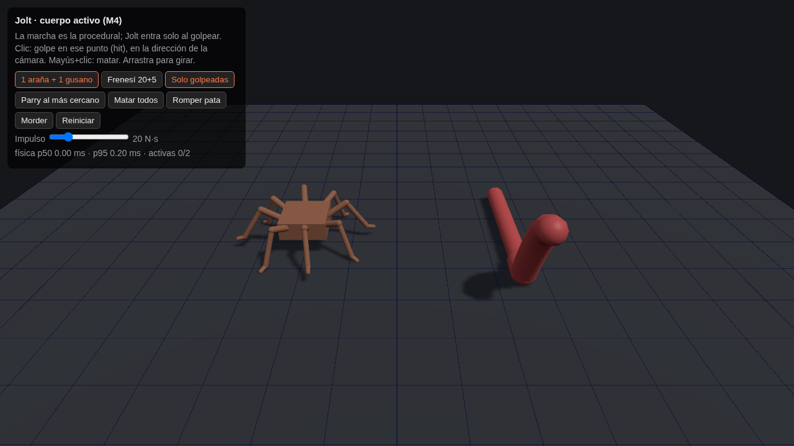

# sendell-motion

Character animation, palm contact and active-ragdoll physics for the web, built on
[three.js](https://threejs.org) and [Jolt Physics](https://github.com/jrouwe/JoltPhysics.js) (WASM). It is the motion
layer we are building for our game Q.D.T., published as a technical record of the work.

By [Sendell](https://sendell.co). Design notes and module docs are in Spanish; this README is in English.



## What it does

- **Active body on demand (`src/fisica/`).** The walk stays 100 % procedural. Jolt wakes up only on a hit, a death
  or a grab. Each body part blends between the procedural pose and the physics pose with its own authority (0..1),
  then hands control back. Sleeping creatures cost nothing.
- **Feet locking (`src/pies/`).** Daniel Holden's foot-locking idea (MIT) with two-bone IK and a stride matched to the
  real speed.
- **Additive layers (`src/capas/`).** Breathe, look, lean and flinch, each with its own per-bone mask.
- **Palm contact (`src/contacto/palma.ts`).** A hand that lands *on* the skinned surface of any body (raycast against
  the deformed `SkinnedMesh`, anchored in the local frame of the bone it touches) without passing through it or
  stopping short.
- **IK helpers (`src/ik/`).** Two-bone IK with a pole and world-space rotation helpers.

Planned, empty on purpose for now: target-aware strike selection (`apuntado/`), motion warping (`warping/`), capsule
sweeps for hit events (`contacto/`) and a richer skeleton (`esqueleto/`).

## Measured (the lab benchmark)

`lab/jolt/` is a self-contained page: a spider and a worm built from primitives, 100 % procedural gaits, Jolt on
demand. In benchmark mode it runs a fixed "frenzy" scene (20 spiders + 5 worms, a hit every 0.4 s, 60 Hz) and the
acceptance tests in [lab/jolt/CRITERIOS.md](lab/jolt/CRITERIOS.md).

Run from this clean copy on a 4-core desktop CPU (8 GB RAM) with headless Chromium 152, 5 s per scene:

| Scene | p50 | p95 | p99 | Awake bodies (mean) |
|---|---|---|---|---|
| All 25 creatures always awake | 7.8 ms | 9.0 ms | 10.0 ms | 25 |
| Only hit or dead creatures awake (the design) | 1.1 ms | 1.7 ms | 2.7 ms | 3.4 |

All six acceptance tests passed with the same numbers as the original record: hit-side deflection ratio 2.13, a
broken leg makes the spider limp (8 vs 20 steps per side), ragdoll death with 0 cm in the floor and walls,
a thrown body leaves at 5.78 m/s for 6 m/s requested, the bite reaches the body at 0–0.7 cm, and rest after physics
returns to the procedural pose (0 cm, 0°) in 0.55 s.

## Run it

Requirements: Node 22+.

```bash
npm ci
npm run tsc          # type check
npm run lab          # the interactive lab at http://localhost:5173/ (click = hit, Shift+click = kill)
npm run lab:build    # build to dist/jolt
npm run lab:banco    # headless benchmark: needs Chrome or Chromium (set CHROME=/path/to/browser)
```

The benchmark result is written to `dist/banco-jolt.json`. Use `?banco=1&s=60` on the lab URL to run it by hand.

## Status (honest)

- Works: the type check, the lab build, the interactive lab and the headless benchmark, all run from this copy.
- The modules are written for our game's 18-bone humanoid naming (`pelvis`, `thigh_L`, `shin_L`, `foot_L`, …) and
  the lab's procedural creatures. There is no npm package, no stable API and no test suite yet.
- Never measured on a real phone.
- Not included: the game itself, its 3D models and clips, the private comparison page that plays them side by side,
  and the in-game frenzy benchmark (it needs a game build). The docs mention them as part of the record.

## License

Proposed: Apache License 2.0 ([LICENSE](LICENSE)). Dependencies: three.js (MIT), jolt-physics (MIT).
Research notes in `docs/` cite third-party work with its own licence; nothing from those projects is vendored here.
